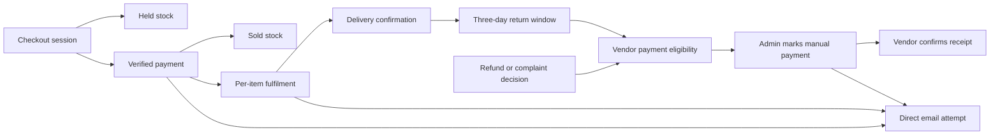

# Elegant Style state-machine inventory

Audit date: 6 November 2026. Scope: the current local application source, hooks, helpers and SQL migrations, including recent notification and image changes. This is a static code audit, not a fresh inspection of production database definitions or a runtime bug reproduction. No application code, database or production deployment was changed for this audit. Deployment is now controlled by the owner.

An **implicit state machine** is a workflow whose next allowed action depends on its current state, but whose state and rules are expressed through booleans, timestamps, conditional statements, event handlers or separate database columns. A status enum alone is not a complete state machine. Some workflows here already have explicit transition guards; those are identified as **partly explicit** rather than incorrectly presented as entirely implicit.

The inventory groups related instances into **44 state-machine families**. This is a review taxonomy, not a claim that the code declares exactly 44 independent formal machines. Simple UI toggles and presentation effects are grouped. Inferred state names describe behaviour; they are not necessarily stored values. Historical migrations are interpreted with later replacements and removals applied.

## Business, identity and persisted workflows

| ID | Workflow | States and transitions | Implementation / authority |
|---|---|---|---|
| 1 | Authentication and profile hydration | Checking session → signed out, or session found → loading profile → active customer/admin/vendor. Inactive accounts sign out. Sign-in/out events update separate user, userData, loading and isAdmin values. | [src/contexts/AuthContext.js:7](<C:/Users/LAPTOP CENTER/Documents/ElegantstylesWebsite/src/contexts/AuthContext.js:7>); server protection: [src/lib/accountServer.js:5](<C:/Users/LAPTOP CENTER/Documents/ElegantstylesWebsite/src/lib/accountServer.js:5>). Implicit composite state. |
| 2 | Signup, confirmation and OAuth | Editing → submitting → confirmation pending → resending/confirmed; alternatively OAuth redirect → callback → session established or error → destination. Duplicate signup gets the same confirmation-pending presentation. | [src/app/sign-up/page.js:30](<C:/Users/LAPTOP CENTER/Documents/ElegantstylesWebsite/src/app/sign-up/page.js:30>); [src/app/sign-in/page.js:51](<C:/Users/LAPTOP CENTER/Documents/ElegantstylesWebsite/src/app/sign-in/page.js:51>); [src/app/auth/callback/page.js:16](<C:/Users/LAPTOP CENTER/Documents/ElegantstylesWebsite/src/app/auth/callback/page.js:16>). |
| 3 | Password recovery | Recovery email form → sending → sent/error. Reset link: checking → ready/invalid; ready → updating → success → redirect, or error → retry. Password visibility is a separate two-state UI control. | [src/app/forgot-password/page.js:12](<C:/Users/LAPTOP CENTER/Documents/ElegantstylesWebsite/src/app/forgot-password/page.js:12>); [src/app/reset-password/page.js:17](<C:/Users/LAPTOP CENTER/Documents/ElegantstylesWebsite/src/app/reset-password/page.js:17>). Reset link state is already explicit; the surrounding workflow is distributed. |
| 4 | Change account password | Idle → checking current password → updating new password → success/error; temporary password-auth client is signed out in finally. | [src/app/account/page.js:38](<C:/Users/LAPTOP CENTER/Documents/ElegantstylesWebsite/src/app/account/page.js:38>); [src/app/api/account/route.js:32](<C:/Users/LAPTOP CENTER/Documents/ElegantstylesWebsite/src/app/api/account/route.js:32>). |
| 5 | Account deactivation and one-time codes | Active → deactivation confirmation → password proof or Google email-code proof → inactive → sessions revoked. Code: absent → issued → valid/expired/exhausted/replaced → consumed/deleted; five attempts and ten-minute expiry. Email failure deletes its matching issued code. | [src/app/account/page.js:50](<C:/Users/LAPTOP CENTER/Documents/ElegantstylesWebsite/src/app/account/page.js:50>); [src/lib/accountDeactivation.mjs:29](<C:/Users/LAPTOP CENTER/Documents/ElegantstylesWebsite/src/lib/accountDeactivation.mjs:29>); [supabase/migrations/20261030180000_google_deactivation_codes.sql:12](<C:/Users/LAPTOP CENTER/Documents/ElegantstylesWebsite/supabase/migrations/20261030180000_google_deactivation_codes.sql:12>); [src/app/api/account/route.js:37](<C:/Users/LAPTOP CENTER/Documents/ElegantstylesWebsite/src/app/api/account/route.js:37>). |
| 6 | Vendor eligibility / role gating | is_vendor false ↔ true, changed offline by administrator; effective vendor access additionally requires active account, verified identity and live session. Admin is an independent flag, not the next step in a role progression. | [src/lib/vendorServer.js:3](<C:/Users/LAPTOP CENTER/Documents/ElegantstylesWebsite/src/lib/vendorServer.js:3>); [supabase/migrations/20261106122642_offline_vendor_approval.sql:9](<C:/Users/LAPTOP CENTER/Documents/ElegantstylesWebsite/supabase/migrations/20261106122642_offline_vendor_approval.sql:9>). The previous invitation lifecycle is retired. |
| 7 | Claiming historical orders for an account | Not linked for this identity → linking → linked/error → explicit retry. Database links matching historical order email once; account pages wait for the identity-specific result. | [src/app/account/AccountShell.js:17](<C:/Users/LAPTOP CENTER/Documents/ElegantstylesWebsite/src/app/account/AccountShell.js:17>); [src/app/api/account/link-orders/route.js:5](<C:/Users/LAPTOP CENTER/Documents/ElegantstylesWebsite/src/app/api/account/link-orders/route.js:5>); [supabase/migrations/20261022115614_fix_legacy_order_link_permissions.sql:6](<C:/Users/LAPTOP CENTER/Documents/ElegantstylesWebsite/supabase/migrations/20261022115614_fix_legacy_order_link_permissions.sql:6>). |
| 8 | Checkout session creation | Absent → creating → open or unknown. Same attempt ID + fingerprint can resume an open session or report already paid. Creating/unknown existing attempts return uncertainty rather than create another payment session. | [src/app/api/checkout/route.js:38](<C:/Users/LAPTOP CENTER/Documents/ElegantstylesWebsite/src/app/api/checkout/route.js:38>); [supabase/migrations/20261016070952_bachs_checkout_orders.sql:17](<C:/Users/LAPTOP CENTER/Documents/ElegantstylesWebsite/supabase/migrations/20261016070952_bachs_checkout_orders.sql:17>). The stored enum is explicit; recovery is implicit. |
| 9 | Payment verification | pending → paid when a verified successful collection matches amount/currency, otherwise → review. review can later become paid on a matching successful event; already-paid events are ignored. paid requires payment identifiers/timestamps and triggers stock commitment. | [src/app/api/bachs/webhook/route.js:11](<C:/Users/LAPTOP CENTER/Documents/ElegantstylesWebsite/src/app/api/bachs/webhook/route.js:11>); [src/lib/bachs.mjs:4](<C:/Users/LAPTOP CENTER/Documents/ElegantstylesWebsite/src/lib/bachs.mjs:4>); [supabase/migrations/20261016070952_bachs_checkout_orders.sql:15](<C:/Users/LAPTOP CENTER/Documents/ElegantstylesWebsite/supabase/migrations/20261016070952_bachs_checkout_orders.sql:15>). |
| 10 | Stock reservation and commitment | Checkout insert → held reservation; verified payment → sold reservation + stock decrement. Availability subtracts held units; reserved stock cannot be removed by edits/deletion. Revision changes reject stale stock writes. No release/expired reservation state was found. | [supabase/migrations/20261021222045_size_stock_reservations.sql:72](<C:/Users/LAPTOP CENTER/Documents/ElegantstylesWebsite/supabase/migrations/20261021222045_size_stock_reservations.sql:72>); [supabase/migrations/20261021222045_size_stock_reservations.sql:97](<C:/Users/LAPTOP CENTER/Documents/ElegantstylesWebsite/supabase/migrations/20261021222045_size_stock_reservations.sql:97>); [supabase/migrations/20261106122642_offline_vendor_approval.sql:12](<C:/Users/LAPTOP CENTER/Documents/ElegantstylesWebsite/supabase/migrations/20261106122642_offline_vendor_approval.sql:12>). |
| 11 | Product lifecycle, visibility and restocking | New owned product → active with stock → unavailable/out of stock when no purchasable sizes → visible again after restock. Vendor removal sets inactive; administrator deletion removes the row and queues media cleanup. Product page lookup can become not-found. Ownership is attached when saved and snapshotted onto order items. | [supabase/migrations/20261106122642_offline_vendor_approval.sql:12](<C:/Users/LAPTOP CENTER/Documents/ElegantstylesWebsite/supabase/migrations/20261106122642_offline_vendor_approval.sql:12>); [supabase/migrations/20261106122642_offline_vendor_approval.sql:44](<C:/Users/LAPTOP CENTER/Documents/ElegantstylesWebsite/supabase/migrations/20261106122642_offline_vendor_approval.sql:44>); [supabase/migrations/20261105161554_public_marketplace_catalog.sql:9](<C:/Users/LAPTOP CENTER/Documents/ElegantstylesWebsite/supabase/migrations/20261105161554_public_marketplace_catalog.sql:9>); [src/app/ready-to-wear/product/[slug]/page.js:15](<C:/Users/LAPTOP CENTER/Documents/ElegantstylesWebsite/src/app/ready-to-wear/product/[slug]/page.js:15>). Visibility is derived, not one stored stock-status enum. |
| 12 | Per-item fulfilment and shop handoff | Direct: new → processing → shipped/ready → completed. Shop handoff: processing → sent_to_shop → at_shop → shipped/ready → completed. Multi-vendor dispatch waits for all vendor items at_shop and admin items processing, then dispatches the whole order. Actor, seller ownership, payment and delivery method guard every action. | [supabase/migrations/20261106122642_offline_vendor_approval.sql:53](<C:/Users/LAPTOP CENTER/Documents/ElegantstylesWebsite/supabase/migrations/20261106122642_offline_vendor_approval.sql:53>); UI action projection: [src/components/SellerOrders.js:5](<C:/Users/LAPTOP CENTER/Documents/ElegantstylesWebsite/src/components/SellerOrders.js:5>). Partly explicit, but branch selection is implicit in flags and order composition. |
| 13 | Whole-order fulfilment projection and legacy fulfilment | Seller-item progress derives order new/processing/ready/shipped/completed. Legacy orders without seller items instead use the admin API transition map. The two paths are deliberately separated by an API guard. | [supabase/migrations/20261105164217_seller_order_progress.sql:2](<C:/Users/LAPTOP CENTER/Documents/ElegantstylesWebsite/supabase/migrations/20261105164217_seller_order_progress.sql:2>); [src/app/api/admin/orders/route.js:45](<C:/Users/LAPTOP CENTER/Documents/ElegantstylesWebsite/src/app/api/admin/orders/route.js:45>); [src/lib/orderManagement.mjs:32](<C:/Users/LAPTOP CENTER/Documents/ElegantstylesWebsite/src/lib/orderManagement.mjs:32>). |
| 14 | Delivery confirmation | New seller items: shipped/ready → customer confirm → completed with confirmed_at. After seven days from payment, administrator may verify delivery with evidence. Legacy orders instead consume a receipt-link hash and set customer_received_at; repeat confirmations return alreadyConfirmed. | [supabase/migrations/20261106122642_offline_vendor_approval.sql:65](<C:/Users/LAPTOP CENTER/Documents/ElegantstylesWebsite/supabase/migrations/20261106122642_offline_vendor_approval.sql:65>); [src/app/api/checkout/orders/[id]/received/route.js:9](<C:/Users/LAPTOP CENTER/Documents/ElegantstylesWebsite/src/app/api/checkout/orders/[id]/received/route.js:9>); [src/app/order-received/[id]/ReceiptConfirmation.js:8](<C:/Users/LAPTOP CENTER/Documents/ElegantstylesWebsite/src/app/order-received/[id]/ReceiptConfirmation.js:8>). Two distinct confirmation records. |
| 15 | Return/refund eligibility clock | Unconfirmed → confirmed/open window → closed exactly at confirmation + three elapsed days. This changes with time even without a write. New request insertion checks the database clock; legacy orders fall back to customer_received_at. | [src/lib/vendorSettlement.mjs:24](<C:/Users/LAPTOP CENTER/Documents/ElegantstylesWebsite/src/lib/vendorSettlement.mjs:24>); [supabase/migrations/20261105160700_seller_order_fulfilment.sql:91](<C:/Users/LAPTOP CENTER/Documents/ElegantstylesWebsite/supabase/migrations/20261105160700_seller_order_fulfilment.sql:91>). Product-level eligibility uses earliest non-null item confirmation. |
| 16 | Refund decision | No request → pending → approved or rejected. Expected-status compare-and-set protects admin review. Approval records a decision, not a transfer of money. A pending or approved refund holds vendor payment. | [src/lib/accountContracts.mjs:18](<C:/Users/LAPTOP CENTER/Documents/ElegantstylesWebsite/src/lib/accountContracts.mjs:18>); [src/app/api/admin/customer-requests/route.js:29](<C:/Users/LAPTOP CENTER/Documents/ElegantstylesWebsite/src/app/api/admin/customer-requests/route.js:29>); [src/lib/supportEmails.mjs:7](<C:/Users/LAPTOP CENTER/Documents/ElegantstylesWebsite/src/lib/supportEmails.mjs:7>). The decision transition map is already explicit. |
| 17 | Product complaint decision | No request → pending → in_review → resolved/rejected; direct pending → resolved/rejected is also permitted. Submission requires receipt acknowledgement; pending/in_review complaints hold payment. | [src/lib/accountContracts.mjs:18](<C:/Users/LAPTOP CENTER/Documents/ElegantstylesWebsite/src/lib/accountContracts.mjs:18>); [src/app/api/account/requests/route.js:27](<C:/Users/LAPTOP CENTER/Documents/ElegantstylesWebsite/src/app/api/account/requests/route.js:27>). Not identical to the refund machine; its own insertion rules apply. |
| 18 | Vendor manual payment and receipt | Undelivered → confirmed but within three-day hold → eligible if no blocking request → administrator marks payment fulfilled → vendor acknowledges receipt. Open refund/complaint overlays eligibility. payment_marked_at and payment_received_at encode progression; no automatic transfer occurs. | [src/lib/vendorSettlement.mjs:19](<C:/Users/LAPTOP CENTER/Documents/ElegantstylesWebsite/src/lib/vendorSettlement.mjs:19>); [supabase/migrations/20261106122642_offline_vendor_approval.sql:71](<C:/Users/LAPTOP CENTER/Documents/ElegantstylesWebsite/supabase/migrations/20261106122642_offline_vendor_approval.sql:71>); [src/components/SellerOrders.js:92](<C:/Users/LAPTOP CENTER/Documents/ElegantstylesWebsite/src/components/SellerOrders.js:92>). |
| 19 | Student application review | No application → pending; admin may set pending/accepted/declined. accepted boolean mirrors status. First acceptance claims the acceptance email. Reversing and later reaccepting does not clear that claim. | [supabase/migrations/20261017112938_account_registration_support.sql:74](<C:/Users/LAPTOP CENTER/Documents/ElegantstylesWebsite/supabase/migrations/20261017112938_account_registration_support.sql:74>); [src/app/api/admin/students/route.js:29](<C:/Users/LAPTOP CENTER/Documents/ElegantstylesWebsite/src/app/api/admin/students/route.js:29>). Allowed values exist; a forward-only review graph does not. |
| 20 | Bespoke request business status | New request stores new. UI offers new/contacted/quoted/confirmed/completed/cancelled. Admin can jump from any current value to any offered different value; there is no expected-status comparison in that update. | [src/app/admin/bespoke/page.js:53](<C:/Users/LAPTOP CENTER/Documents/ElegantstylesWebsite/src/app/admin/bespoke/page.js:53>); [supabase/migrations/20250101_bespoke_requests.sql:26](<C:/Users/LAPTOP CENTER/Documents/ElegantstylesWebsite/supabase/migrations/20250101_bespoke_requests.sql:26>). These labels suggest a workflow but the code does not enforce that sequence. |
| 21 | Product special-order enquiry | Customer enters requirements → submits a stable request ID/body → saved or duplicate/conflict → optional admin email retry. email_sent_at distinguishes notified from still needing email. No contacted/quoted/completed business lifecycle is implemented for enquiries. | [src/app/ready-to-wear/product/[slug]/ProductDetails.js:23](<C:/Users/LAPTOP CENTER/Documents/ElegantstylesWebsite/src/app/ready-to-wear/product/[slug]/ProductDetails.js:23>); [src/app/api/product-requests/route.js:10](<C:/Users/LAPTOP CENTER/Documents/ElegantstylesWebsite/src/app/api/product-requests/route.js:10>); [src/app/api/admin/product-requests/route.js:24](<C:/Users/LAPTOP CENTER/Documents/ElegantstylesWebsite/src/app/api/admin/product-requests/route.js:24>). |
| 22 | Email attempts and notification claims | Action saved → email attempted → provider accepted or attempt failed. Shared service sender retries transient failures up to three attempts; paid-order sender has a separate one-attempt implementation. Paid-order/acceptance claims are recorded before send; some registration/enquiry email timestamps are recorded after send. Provider acceptance is not inbox delivery. | [src/lib/orderEmails.mjs:25](<C:/Users/LAPTOP CENTER/Documents/ElegantstylesWebsite/src/lib/orderEmails.mjs:25>); [src/lib/orderEmails.mjs:135](<C:/Users/LAPTOP CENTER/Documents/ElegantstylesWebsite/src/lib/orderEmails.mjs:135>); [src/app/api/bachs/webhook/route.js:38](<C:/Users/LAPTOP CENTER/Documents/ElegantstylesWebsite/src/app/api/bachs/webhook/route.js:38>); [src/app/api/admin/students/route.js:18](<C:/Users/LAPTOP CENTER/Documents/ElegantstylesWebsite/src/app/api/admin/students/route.js:18>). No vendor notification queue remains. |
| 23 | Media deletion / cleanup | Record removed or image replaced → queued object → checked for remaining references → storage removal → queue row removed. Failure keeps the entry; objects still referenced are skipped. UI can retry cleanup. Record deletion and physical object deletion are separate states. | [src/lib/storageCleanup.mjs:3](<C:/Users/LAPTOP CENTER/Documents/ElegantstylesWebsite/src/lib/storageCleanup.mjs:3>); [src/app/api/admin/media/route.js:17](<C:/Users/LAPTOP CENTER/Documents/ElegantstylesWebsite/src/app/api/admin/media/route.js:17>); [src/components/MediaCleanupNotice.js:5](<C:/Users/LAPTOP CENTER/Documents/ElegantstylesWebsite/src/components/MediaCleanupNotice.js:5>). |

## Client workflows, media and background state

| ID | Workflow | States and transitions | Implementation / authority |
|---|---|---|---|
| 24 | Cart contents and cross-tab synchronization | Unhydrated → localStorage hydrated → add/change/remove → persisted + event synchronization. Size/quantity validity depends on live limits. A paid order subtracts purchased units once using es_paid_ORDER_ID, preserving later cart additions. | [src/contexts/CartContext.js:13](<C:/Users/LAPTOP CENTER/Documents/ElegantstylesWebsite/src/contexts/CartContext.js:13>); [src/lib/checkout.mjs:56](<C:/Users/LAPTOP CENTER/Documents/ElegantstylesWebsite/src/lib/checkout.mjs:56>); [src/app/checkout/success/page.js:11](<C:/Users/LAPTOP CENTER/Documents/ElegantstylesWebsite/src/app/checkout/success/page.js:11>). |
| 25 | Cart drawer, focus and feedback | Closed ↔ open; opening locks body scroll and captures focus, closing restores them. Add/error notice → visible → cleared after 3.5 seconds. Escape, outside click and navigation close the drawer. | [src/contexts/CartContext.js:16](<C:/Users/LAPTOP CENTER/Documents/ElegantstylesWebsite/src/contexts/CartContext.js:16>). These are parallel presentation states, separate from cart data. |
| 26 | Checkout UI orchestration | Auth/loading → empty/unavailable or ready → submitting → redirect/paid/failed/uncertain. Uncertain disables resubmission; cancelled return can route to existing status page. Attempt ID, pending request and attempted cart live in refs alongside booleans. | [src/app/checkout/page.js:19](<C:/Users/LAPTOP CENTER/Documents/ElegantstylesWebsite/src/app/checkout/page.js:19>); [src/app/checkout/page.js:92](<C:/Users/LAPTOP CENTER/Documents/ElegantstylesWebsite/src/app/checkout/page.js:92>). High-risk implicit composite state. |
| 27 | Payment-return polling | Initial check → pending → poll every three seconds, up to 20 pending responses → waiting for manual retry; paid → cart cleanup; review/error → customer guidance. Checking is also reused for manual refresh. | [src/app/checkout/success/page.js:30](<C:/Users/LAPTOP CENTER/Documents/ElegantstylesWebsite/src/app/checkout/success/page.js:30>). Poll exhaustion is implicit in a local counter, not stored status. |
| 28 | Customer support request form and review editor | No selection → selected order/product → drafting → submitting → saved/duplicate/error; admin selection → review draft → saving → updated/conflict/error. Stable request IDs protect customer retries. | [src/app/account/orders/page.js:24](<C:/Users/LAPTOP CENTER/Documents/ElegantstylesWebsite/src/app/account/orders/page.js:24>); [src/components/SupportRequests.js:9](<C:/Users/LAPTOP CENTER/Documents/ElegantstylesWebsite/src/components/SupportRequests.js:9>); [src/app/api/account/requests/route.js:43](<C:/Users/LAPTOP CENTER/Documents/ElegantstylesWebsite/src/app/api/account/requests/route.js:43>). |
| 29 | Academy form, draft and passport upload | Auth/application preflight → draft restoration → editing/validation → passport uploading/uploaded/failed → submitting → success modal → registration details. Draft-loaded and checking-registration flags gate effects; passport progress is simulated until upload finishes. | [src/app/course/page.js:116](<C:/Users/LAPTOP CENTER/Documents/ElegantstylesWebsite/src/app/course/page.js:116>); [src/app/course/page.js:192](<C:/Users/LAPTOP CENTER/Documents/ElegantstylesWebsite/src/app/course/page.js:192>); [src/app/api/registrations/route.js:9](<C:/Users/LAPTOP CENTER/Documents/ElegantstylesWebsite/src/app/api/registrations/route.js:9>). Multiple coupled machines, not one submitting flag. |
| 30 | Bespoke reference preparation and submission | Selected files → HEIC conversion if necessary → resize/compress → previews → signed upload URLs → parallel uploads → request submission → success/error. Drag/drop and removal affect the prepared set. Partial upload success is possible before request failure. | [src/app/bespoke/request/page.js:39](<C:/Users/LAPTOP CENTER/Documents/ElegantstylesWebsite/src/app/bespoke/request/page.js:39>); [src/app/bespoke/request/page.js:227](<C:/Users/LAPTOP CENTER/Documents/ElegantstylesWebsite/src/app/bespoke/request/page.js:227>); [src/app/api/bespoke/upload-url/route.ts:63](<C:/Users/LAPTOP CENTER/Documents/ElegantstylesWebsite/src/app/api/bespoke/upload-url/route.ts:63>). |
| 31 | Product editor and photo upload | Vendor list → new/edit form → uploading or saving → saved/error/conflict → reload. Admin has editMode/editId/formData/saving equivalents. Photo server pipeline: validate → decode → rotate/resize → WebP → storage → URL assigned; metadata save occurs separately. | [src/components/VendorProductManager.js:44](<C:/Users/LAPTOP CENTER/Documents/ElegantstylesWebsite/src/components/VendorProductManager.js:44>); [src/app/admin/products/page.js:82](<C:/Users/LAPTOP CENTER/Documents/ElegantstylesWebsite/src/app/admin/products/page.js:82>); [src/components/ProductForm.js:6](<C:/Users/LAPTOP CENTER/Documents/ElegantstylesWebsite/src/components/ProductForm.js:6>); [src/lib/optimizeProductImage.mjs:6](<C:/Users/LAPTOP CENTER/Documents/ElegantstylesWebsite/src/lib/optimizeProductImage.mjs:6>); [src/lib/productImageUpload.js:5](<C:/Users/LAPTOP CENTER/Documents/ElegantstylesWebsite/src/lib/productImageUpload.js:5>). Shared form, independent orchestration. |
| 32 | Product choice and add-to-cart eligibility | Unselected size → selected valid size → quantity constrained by purchase limit → add succeeds/error. Changing size resets/clamps quantity. Out-of-stock product can instead enter the enquiry workflow. | [src/app/ready-to-wear/product/[slug]/ProductDetails.js:17](<C:/Users/LAPTOP CENTER/Documents/ElegantstylesWebsite/src/app/ready-to-wear/product/[slug]/ProductDetails.js:17>); [src/components/ProductOptions.js:6](<C:/Users/LAPTOP CENTER/Documents/ElegantstylesWebsite/src/components/ProductOptions.js:6>); [src/components/CartContents.js:16](<C:/Users/LAPTOP CENTER/Documents/ElegantstylesWebsite/src/components/CartContents.js:16>). |
| 33 | Runway data selection and navigation restoration | Loading catalog → selected products or empty/error. Back navigation may restore session products/position/target before refresh. Prior selection + lastSeenAt govern replacement only when newer products exist. Local fixture mode is a separate development-only branch. | [src/components/HomeRunwayLookbook.js:13](<C:/Users/LAPTOP CENTER/Documents/ElegantstylesWebsite/src/components/HomeRunwayLookbook.js:13>); [src/lib/runwaySelection.mjs:1](<C:/Users/LAPTOP CENTER/Documents/ElegantstylesWebsite/src/lib/runwaySelection.mjs:1>). |
| 34 | Runway motion and gestures | Idle → automatic advance → easing/settled; pointer down → dragging → moved threshold → release/snap → settle. A moved drag suppresses product navigation. Horizontal wheel and keyboard change target; visibility/pageshow resets clock; reduced motion changes interpolation/advance behaviour. | [src/components/HomeRunwayLookbook.js:45](<C:/Users/LAPTOP CENTER/Documents/ElegantstylesWebsite/src/components/HomeRunwayLookbook.js:45>); [src/components/HomeRunwayLookbook.js:88](<C:/Users/LAPTOP CENTER/Documents/ElegantstylesWebsite/src/components/HomeRunwayLookbook.js:88>). Position is continuous state; modes and events are discrete state. |
| 35 | Runway image/catalog placeholders | Catalog pending → skeletons → products/empty. Individual image loading → loaded or failed; skeleton unmounts on either outcome, and image fades in only when loaded. Source changes remount the image component. | [src/components/RunwayImage.js:6](<C:/Users/LAPTOP CENTER/Documents/ElegantstylesWebsite/src/components/RunwayImage.js:6>); [src/components/HomeRunwayLookbook.js:41](<C:/Users/LAPTOP CENTER/Documents/ElegantstylesWebsite/src/components/HomeRunwayLookbook.js:41>); [src/components/HomeRunwayLookbook.module.css:31](<C:/Users/LAPTOP CENTER/Documents/ElegantstylesWebsite/src/components/HomeRunwayLookbook.module.css:31>). Individual image state is already explicit. |
| 36 | Hero and social-carousel presentation | Hero slide index advances on a timer, with old/new opacity and transform states. Social track loops through duplicated groups; CSS hover/focus/reduced-motion rules control presentation. These are visual state systems, not persisted workflows. | [src/app/page.js:31](<C:/Users/LAPTOP CENTER/Documents/ElegantstylesWebsite/src/app/page.js:31>); [src/components/SocialCarousel.js:7](<C:/Users/LAPTOP CENTER/Documents/ElegantstylesWebsite/src/components/SocialCarousel.js:7>); [src/components/SocialCarousel.module.css:29](<C:/Users/LAPTOP CENTER/Documents/ElegantstylesWebsite/src/components/SocialCarousel.module.css:29>). |
| 37 | Cookie consent | Not hydrated → unknown or valid saved choice → banner or hidden; settings closed ↔ open; draft analytics choice → saved all/necessary → broadcast event. Saved choice expires after 180 days and returns to unknown. | [src/components/CookieConsent.js:10](<C:/Users/LAPTOP CENTER/Documents/ElegantstylesWebsite/src/components/CookieConsent.js:10>); [src/lib/cookieConsent.js:14](<C:/Users/LAPTOP CENTER/Documents/ElegantstylesWebsite/src/lib/cookieConsent.js:14>). Storage and UI states are separate. |
| 38 | Navigation and account access presentation | Mobile menu closed/open, navbar visible/hidden based on scroll, cart feedback animation; menus close on route/user actions. Admin/account shells render loading, redirect/access denied or authorized content. Vendor navigation waits for identity-specific permission lookup. | [src/components/Navbar.js:96](<C:/Users/LAPTOP CENTER/Documents/ElegantstylesWebsite/src/components/Navbar.js:96>); [src/app/admin/layout.js:5](<C:/Users/LAPTOP CENTER/Documents/ElegantstylesWebsite/src/app/admin/layout.js:5>); [src/app/account/AccountShell.js:20](<C:/Users/LAPTOP CENTER/Documents/ElegantstylesWebsite/src/app/account/AccountShell.js:20>). Simple parallel UI machines grouped here. |
| 39 | Query, filter and paginated-list loading | Initial/loading → populated/empty/error; query/filter/page changes → debounce → fetch; replacement/unmount → abort. Admin students/bespoke share a hook; products, shop, orders, vendor search and dashboards implement related variants. | [src/hooks/useAdminList.js:5](<C:/Users/LAPTOP CENTER/Documents/ElegantstylesWebsite/src/hooks/useAdminList.js:5>); [src/app/ready-to-wear/page.js:10](<C:/Users/LAPTOP CENTER/Documents/ElegantstylesWebsite/src/app/ready-to-wear/page.js:10>); [src/app/admin/products/page.js:44](<C:/Users/LAPTOP CENTER/Documents/ElegantstylesWebsite/src/app/admin/products/page.js:44>); [src/app/admin/vendors/page.js:5](<C:/Users/LAPTOP CENTER/Documents/ElegantstylesWebsite/src/app/admin/vendors/page.js:5>); [src/app/admin/orders/page.js:25](<C:/Users/LAPTOP CENTER/Documents/ElegantstylesWebsite/src/app/admin/orders/page.js:25>). Empty is not interchangeable with loading/error. |
| 40 | Purchase-limit subscriptions and request batching | Unobserved → subscribed → queued → fetching → fresh/error → stale → refreshing. One in-flight job per product is shared; listeners start/stop a 15-second visible-page refresh timer. Focus/visibility can refresh. Last unsubscribe tears down timer/listeners. | [src/lib/purchaseLimitStore.mjs:5](<C:/Users/LAPTOP CENTER/Documents/ElegantstylesWebsite/src/lib/purchaseLimitStore.mjs:5>); [src/hooks/usePurchaseLimits.js:6](<C:/Users/LAPTOP CENTER/Documents/ElegantstylesWebsite/src/hooks/usePurchaseLimits.js:6>). This is current stock polling, not retired vendor-notification polling. |
| 41 | Browser cache lifetime | Missing → written/fresh → expired or malformed → removed; explicit invalidation forces missing. Used for drafts and cached browser data, independent of React loading flags. | [src/lib/browserCache.js:17](<C:/Users/LAPTOP CENTER/Documents/ElegantstylesWebsite/src/lib/browserCache.js:17>); [src/lib/browserCache.js:35](<C:/Users/LAPTOP CENTER/Documents/ElegantstylesWebsite/src/lib/browserCache.js:35>). |
| 42 | Private image authorization and URL lifetime | Path validation → signing request → signed URL or unavailable; signed URL eventually expires. Passport signing occurs on value change; bespoke admin image signing occurs on list change. Expiry is external/time-driven, not a React event. | [src/components/PassportPhoto.js:6](<C:/Users/LAPTOP CENTER/Documents/ElegantstylesWebsite/src/components/PassportPhoto.js:6>); [src/app/admin/bespoke/page.js:38](<C:/Users/LAPTOP CENTER/Documents/ElegantstylesWebsite/src/app/admin/bespoke/page.js:38>). Passport loading and unavailable currently share one message. |
| 43 | Rate-limit windows | Allowed → limit consumed → blocked → window reset. Separate client-local and database counters govern auth/forms/checkout/account actions; they are not one shared counter. Clock/window boundaries drive reset. | [src/lib/sanitizeInput.js:36](<C:/Users/LAPTOP CENTER/Documents/ElegantstylesWebsite/src/lib/sanitizeInput.js:36>); [supabase/migrations/20261030180000_google_deactivation_codes.sql:35](<C:/Users/LAPTOP CENTER/Documents/ElegantstylesWebsite/supabase/migrations/20261030180000_google_deactivation_codes.sql:35>); [src/app/api/checkout/route.js:74](<C:/Users/LAPTOP CENTER/Documents/ElegantstylesWebsite/src/app/api/checkout/route.js:74>). |
| 44 | Small effects and interaction lifecycles | Scroll reveal: pending observation → revealed/unobserved. Cart flight: created → animating → removed, including rejected animation promise. Back-to-top: hidden/visible at scroll threshold. Product option fields, password visibility, dialogs and selected tabs add simple local states rather than new business workflows. | [src/hooks/useScrollReveal.js:5](<C:/Users/LAPTOP CENTER/Documents/ElegantstylesWebsite/src/hooks/useScrollReveal.js:5>); [src/lib/cartAnimation.js:1](<C:/Users/LAPTOP CENTER/Documents/ElegantstylesWebsite/src/lib/cartAnimation.js:1>); [src/components/BackToTopButton.js:5](<C:/Users/LAPTOP CENTER/Documents/ElegantstylesWebsite/src/components/BackToTopButton.js:5>). |

## Most important findings

### 1. Stock holds have no implemented release transition — high priority

The reservation table permits held and sold only. Inserting an order creates held rows; successful payment changes them to sold. I found no release/expiry/cancellation operation in the current src, migration and operational script searches. Checkout cancellation is a browser-return condition, not a database stock release. An unpaid or uncertain checkout can therefore continue subtracting from available stock indefinitely under the repository's current logic. Held reservations also prevent product deletion and reducing reserved quantities.

Evidence: [supabase/migrations/20261021222045_size_stock_reservations.sql:14](<C:/Users/LAPTOP CENTER/Documents/ElegantstylesWebsite/supabase/migrations/20261021222045_size_stock_reservations.sql:14>); [supabase/migrations/20261021222045_size_stock_reservations.sql:97](<C:/Users/LAPTOP CENTER/Documents/ElegantstylesWebsite/supabase/migrations/20261021222045_size_stock_reservations.sql:97>); [src/app/api/checkout/route.js:118](<C:/Users/LAPTOP CENTER/Documents/ElegantstylesWebsite/src/app/api/checkout/route.js:118>).

This is a static implementation gap. Production reservation counts and external/manual cleanup were not inspected. A future fix must reconcile payment-provider status before releasing holds, because a late successful payment can otherwise oversell inventory.

### 2. Notification claims and delivery outcomes are different states — high priority

Paid orders record emails_claimed_at during payment update, then attempt sending. A repeat successful webhook exits once paid, so it does not retry a failed email. Student acceptance claims are likewise written before sending, and later acceptance does not reclaim them. Seller actions save progress first and report emailSent false on failure, but do not expose a separate retry action. These are valid direct-send flows, but failure after claim needs its own recovery state.

Evidence: [src/app/api/bachs/webhook/route.js:33](<C:/Users/LAPTOP CENTER/Documents/ElegantstylesWebsite/src/app/api/bachs/webhook/route.js:33>); [supabase/migrations/20261017112938_account_registration_support.sql:81](<C:/Users/LAPTOP CENTER/Documents/ElegantstylesWebsite/supabase/migrations/20261017112938_account_registration_support.sql:81>); [src/app/api/account/seller-orders/route.js:129](<C:/Users/LAPTOP CENTER/Documents/ElegantstylesWebsite/src/app/api/account/seller-orders/route.js:129>).

This does **not** recommend restoring vendor-notification polling. Recovery could use explicit per-event send results and administrator-triggered or event-triggered retries with idempotency. Also, everyone uses the same provider, but retry/claim behaviour is not identical across all email paths: paid-order mail uses its own single-attempt sender while service mail retries transient failures.

### 3. Auth hydration can resolve after the identity changed — medium priority

loadUserData checks mounted, but does not verify that its requested user is still the current identity before assigning userData/isAdmin. A profile request started by SIGNED_IN may resolve after SIGNED_OUT or a different sign-in. Separate flags can temporarily disagree. This is a client-state race risk, not a demonstrated server authorization bypass; sensitive server handlers independently validate identity, account status and permission.

Evidence: [src/contexts/AuthContext.js:66](<C:/Users/LAPTOP CENTER/Documents/ElegantstylesWebsite/src/contexts/AuthContext.js:66>); [src/contexts/AuthContext.js:91](<C:/Users/LAPTOP CENTER/Documents/ElegantstylesWebsite/src/contexts/AuthContext.js:91>); [src/lib/accountServer.js:5](<C:/Users/LAPTOP CENTER/Documents/ElegantstylesWebsite/src/lib/accountServer.js:5>).

### 4. Bespoke and student statuses do not enforce a forward-only workflow — medium priority

Bespoke status pills accept any offered next value and update by ID without checking the previous value. Student review accepts any of its three statuses. A completed bespoke request can return to new, and accepted/declined applications can return to pending. This may be intentional administrator flexibility, but it must not be mistaken for a guarded sequence. Concurrent bespoke edits can overwrite one another.

Evidence: [src/app/admin/bespoke/page.js:53](<C:/Users/LAPTOP CENTER/Documents/ElegantstylesWebsite/src/app/admin/bespoke/page.js:53>); [supabase/migrations/20261017112938_account_registration_support.sql:74](<C:/Users/LAPTOP CENTER/Documents/ElegantstylesWebsite/supabase/migrations/20261017112938_account_registration_support.sql:74>). Compare the explicit expectedStatus guards already used for refunds/complaints and legacy fulfilment.

### 5. Delivery/return/payment have two record granularities — review before refactoring

Legacy receipt confirmation records shop_orders.customer_received_at; new marketplace delivery uses seller_order_items.confirmed_at. The refund trigger intentionally falls back to the legacy order timestamp only when seller rows do not exist. However, when one product occurs across multiple size lines, it uses min(confirmed_at), which ignores unconfirmed null rows. The first confirmed line can start the product-level three-day deadline while another size line remains unconfirmed. Confirm whether the desired rule is per line, per product or after all units of a product arrive.

Evidence: [supabase/migrations/20261105160700_seller_order_fulfilment.sql:96](<C:/Users/LAPTOP CENTER/Documents/ElegantstylesWebsite/supabase/migrations/20261105160700_seller_order_fulfilment.sql:96>); [src/app/api/checkout/orders/[id]/received/route.js:21](<C:/Users/LAPTOP CENTER/Documents/ElegantstylesWebsite/src/app/api/checkout/orders/[id]/received/route.js:21>). This is a business-rule edge case identified statically, not a claim that it has occurred to a customer.

### 6. Time-based state changes do not always trigger a UI update — lower priority

Payment eligibility and return deadlines change with elapsed time, but seller screens mainly update on fetch/action/render. They do not receive a dedicated event exactly when a seven-day or three-day boundary passes. Private signed URLs similarly expire without automatically renewing on a timer in the inspected components. A refresh may be needed to show newly available actions or obtain new links. Server-side deadline checks remain authoritative.

Evidence: [src/components/SellerOrders.js:12](<C:/Users/LAPTOP CENTER/Documents/ElegantstylesWebsite/src/components/SellerOrders.js:12>); [src/lib/vendorSettlement.mjs:19](<C:/Users/LAPTOP CENTER/Documents/ElegantstylesWebsite/src/lib/vendorSettlement.mjs:19>); [src/components/PassportPhoto.js:11](<C:/Users/LAPTOP CENTER/Documents/ElegantstylesWebsite/src/components/PassportPhoto.js:11>).

## Coupled workflows worth making explicit first

The diagram shows dependencies, not a single linear machine. For example, an order can be paid while its checkout session remains recorded as open, and an order can be shipped while only some items are confirmed. Replacing every column with one giant status would lose useful parallel state.

Recommended first candidates: checkout + reservation recovery; item fulfilment + delivery confirmation; return/complaint holds + manual payment; notification recovery; identity/profile hydration. Explicit transition functions, event names and invariants can improve these without requiring a state-machine library.

## Historical or inactive machines not counted as current workflows

- vendor_accounts.status still describes not_invited/pending/active/declined/revoked in old migrations. Current approval uses users.is_vendor; invitation and online-terms transitions are retired.
- vendor_notifications queue/retry/backoff and vendor_terms_acceptances are removed by later migrations. They are not current notification/onboarding machines.
- Database carts declare active/converted/abandoned in the early schema, but I found no current src call to that carts workflow or its cart mutation RPCs. The live application path inspected uses localStorage cart state. Treat the database lifecycle as legacy/unwired until any external consumers are checked.
- ProductGrid.tsx contains its own loading state but has no importer in the current src search. Do not count it as an active route workflow without tracing an entry point.
- Framework request/render/hydration machinery, Supabase SDK internals, payment-provider internals and CI/deployment pipelines are outside this application-state inventory. Local generated runway fixtures are not production workflow behaviour.

## Method and limitations

Used the existing Graphify graph to locate relationships, then checked current source, state hooks, refs, event/timer handlers, enums, API branches, SQL guards/triggers and later migration replacements. Graphify's map predates some recent changes, so graph edges were navigation aids rather than proof of current behaviour. No exhaustive runtime model checking was performed. Suggested risks above are qualified accordingly. No new agent subtask, production request, SQL mutation or deployment was performed for this audit.
